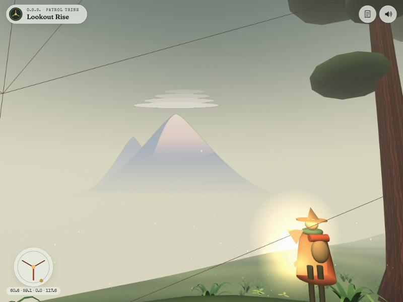
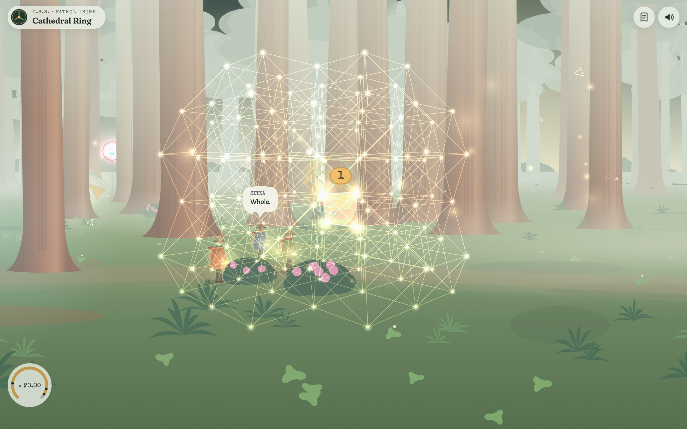

# Cascadian Synergetics

Two patrols through a fog-bound Cascadian redwood grove, where the Office of Synergetics Services keeps space from growing square.

[](https://doi.org/10.5281/zenodo.24508082)



| Game | Kind | Source | Standalone page |
|------|------|--------|-----------------|
| Cascadian Field Station | First person, 3D (Three.js r128) | [`src/field-station.html`](src/field-station.html) | [`field-station/`](field-station/) |
| Office of Synergetics Services | Storybook, 2.5D (Canvas 2D) | [`src/storybook.html`](src/storybook.html) | [`storybook/`](storybook/) |

Each game is a single HTML file that needs nothing beyond fonts and, for the field station, Three.js from cdnjs. In both games the coordinates, self-checks and counting come from two sibling projects, [QuadCraft](https://github.com/docxology/QuadCraft) and [QuadMath](https://github.com/docxology/QuadMath). Their code is spliced into the page byte for byte from `vendor/` and `lib/`, and tested against upstream; see [docs/imports.md](docs/imports.md).

## Play

**In a browser.** GitHub Pages serves both games straight from this repository: the [landing page](https://docxology.github.io/Cascadian_Synergetics/), the [Cascadian Field Station](https://docxology.github.io/Cascadian_Synergetics/field-station/) and the [storybook patrol](https://docxology.github.io/Cascadian_Synergetics/storybook/). The field station needs WebGL and a network connection for Three.js.

**Hosted as Claude artifacts.** The same files are published as [Cascadian Field Station](https://claude.ai/artifact/H96uDqtq776RDTxr9AWfiG) and the [storybook patrol](https://claude.ai/artifact/9tZNx7B6G3egbtkoinNyo6). They open for anyone the owner has shared them with.

**Locally.** Serve the folder and open the landing page:

```bash
python3 -m http.server 8000
```

Then visit `http://localhost:8000/`. The storybook also opens straight from the file. The field station needs a network connection for Three.js.

## The patrol

Patrol Trine is you, Ranger Sitka and Ranger Madrone. The grove has no briefing screen and no explanations; things show you what they are.

- **Incursions.** Five humming cubes lay a square grid over the moss and turn nearby ferns to pixels. Raise lanterns, and the three rangers stand on a triangle while light comes down from the canopy. The cube folds into the tetrahedron on its face diagonals; its four corner pieces flutter away and a triangular lattice blooms where the grid was.
- **Masts.** Three tensegrity masts have gone slack. Pluck their cables in time and they pull taut and sing.
- **Banana slugs.** Kneel and survey three of them. Don't hurry them.
- **Insignia.** Eight pins, coins and patches from the gallery lie on the forest floor. Found ones ride on the rangers' coats.
- **The Cathedral Ring.** A Vector Equilibrium floats at the centre, stiff at first, with square gaps glitching. Each task lets it breathe further through its jitterbug. When the grove is whole it breathes all the way, and the view lifts into the canopy.

Both games carry things that are never named:

- Stand still for a few seconds and the isotropic vector matrix appears around you, fixed to the world. Each node has a whole quadray address, counted out from the foot of the Ring; the action button shows the one you would mark.
- Mark four nodes and the tetrahedron between them lights while a brass counter clicks out its volume. It always comes out whole, and the notebook keeps the counts. In the field station you face a node; in the storybook you tap one, or press E for the node by your lantern.
- At the Ring, a brass dial follows the jitterbug's volume as it breathes.
- A brass rail by the station door carries eight beads, one for each of the station's self-checks, lit when the check passes.
- Every few minutes the ground hums. Re-tensioned masts ring their chords and slack ones rattle, and the radio reports in.
- The station's mailbox raises its flag now and then. Open it and the tetrahedron that lives inside eats the envelope and leaves a postcard.
- Roosevelt elk graze in the fog, and the bull bugles. Marbled murrelets cross overhead on their way in from the coast. Ash drifts down over the station, each flake a tiny vector equilibrium.
- From Lookout Rise, a lenticular cloud stands over the peaks and the sun is red.
- Sometimes a tall figure waits at the fog's edge, off to one side, after two wood knocks. Turn to it and it is gone.
- Somewhere in the grove there is a white redwood.
- At Public Works the ants build a tetrahedron out of Fuller's A-modules, one sliver at a time, then let it go and start again.
- Stand still by a fallen log and the foxfire in the rotting wood begins to glow.
- A rough-skinned newt crosses the trail in no hurry. Come close and it arches to show its orange underside.

The field station adds what a first-person view can give: the mountain standing up out of the fog from the summit of Lookout Rise; with the sun at your back up there, the patrol's three shadows on the fog below, a glory of coloured rings round one head only, yours; and Highway 101 along the grove's west edge, where cars pass in the fog lights first and Dot keeps the diner. The storybook keeps its own diner on 101, its salmon run, its ant crew and its flooded roots.

## Controls

| | Field station | Storybook |
|---|---|---|
| Walk | WASD or arrows; R keeps walking on its own; left thumb on a phone | WASD or arrows, or tap the ground; R keeps walking on its own |
| Look | Click the grove for mouse look (Esc releases), or drag; right thumb on a phone | |
| Act | E, Space, click, or the button at the bottom; also marks a lattice node | E, Space, or the button at the bottom; tap a lattice node to mark it |
| Notebook | L | L |
| Sound | M | M |

## Repository layout

```
src/                       the two games exactly as published to Claude (no <html>/<head>/<body>)
storybook/                 standalone storybook page, built from src/
field-station/             standalone field-station page, built from src/
index.html                 landing page with both doors
vendor/                    QuadCraft and QuadMath files, byte for byte, pinned in vendor.lock.json
lib/tetravolume.js         QuadMath's exact 5x5 tetravolume and Bareiss determinant, ported to JavaScript
lib/grove-geometry.js      the jitterbug, its volume, the lattice and its addresses, the ash: shared by both games
tools/build.mjs            splices vendor/ and lib/ into src/, then builds the standalone pages
tools/vendor.mjs           checks vendor/ against the lock (and upstream clones); refreshes it
tools/quadmath_fixtures.py runs the vendored QuadMath to write tests/fixtures/quadmath.json
tests/check.mjs            parse, artifact, freshness, import, port and geometry checks
tools/ci.mjs               local CI: the checks on a clean export of one commit, with an optional receipt
.githooks/pre-push         runs local CI on every commit being pushed
tools/facts.mjs            computes every number the docs and the manuscript state; --check fails on a stale or typed one
docs/                      design, synergetics, imports and Cascadia notes, and the images
docs/manuscript/           the paper about the games, rendered through docxology/template
scripts/                   the manuscript build: figures, tokens, render, render contract
output/pdf/                the rendered paper and the digests binding it to its sources
```

## Development

The [documentation index](docs/README.md) links to the game build, geometry,
local CI, contributed code, and paper source. See
[Develop and verify](docs/development.md) for the commands.

## The paper

[`output/pdf/Cascadian_Synergetics_combined.pdf`](output/pdf/Cascadian_Synergetics_combined.pdf) is a paper about the games: what they show, the geometry behind it, how the imported code is held to its sources, the real Cascadia behind the grove, and how every claim is checked. Its source is [`docs/manuscript/`](docs/manuscript/), rendered by the [docxology/template](https://github.com/docxology/template) pipeline. Follow the [pinned build guide](docs/manuscript-build.md) for the figure, hydration, PDF, and validation commands.

Release 0.5.1, the paper and the source at its tag, is archived on Zenodo as [doi:10.5281/zenodo.24511763](https://doi.org/10.5281/zenodo.24511763), release 0.5.0 as [doi:10.5281/zenodo.24511112](https://doi.org/10.5281/zenodo.24511112), and release 0.4.0 as [doi:10.5281/zenodo.24508085](https://doi.org/10.5281/zenodo.24508085); [doi:10.5281/zenodo.24508082](https://doi.org/10.5281/zenodo.24508082) always resolves to the latest archived release.

## Sources and credits

- The [Office of Synergetics Services](https://docs.superhuman.com/d/Math4Wisdom_d0SvdI3KSto/Office-of-Synergetics-Services_suFScEwl) gallery in Math4Wisdom: the station, the ants' public works, the pins and coins, the salmon and the tetrahedron, the fire lookout.
- R. Buckminster Fuller's *Synergetics*: the jitterbug, tetravolumes, the isotropic vector matrix, tensegrity.
- Quadray coordinates as developed in the synergetics community, and Tom Ace's 5×5 determinant for tetravolumes.
- [QuadCraft](https://github.com/docxology/QuadCraft) (Apache-2.0): `quadray.js` and `synergetics.js`, vendored at `6b5e65f`.
- [QuadMath](https://github.com/docxology/QuadMath) (Apache-2.0, manuscript [doi:10.5281/zenodo.16887791](https://doi.org/10.5281/zenodo.16887791)): the exact tetravolume and Bareiss determinant, ported from `6e1f004`.
- [Three.js](https://threejs.org/) r128 (MIT). Fonts: Fraunces, Alegreya Sans and Special Elite from Google Fonts.

Notes on the geometry and on the real Cascadia behind the grove are in the [documentation](docs/README.md). Releases are listed in [CHANGELOG.md](CHANGELOG.md).



## License

MIT for this repository's own code. See [LICENSE](LICENSE) and [CITATION.cff](CITATION.cff). The files in `vendor/` keep their upstream Apache-2.0 licence, whose text is beside them, and `lib/tetravolume.js` is a port of Apache-2.0 code that says so in its header.
